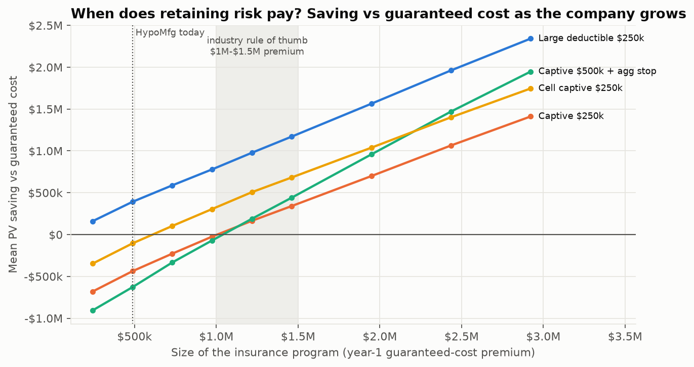
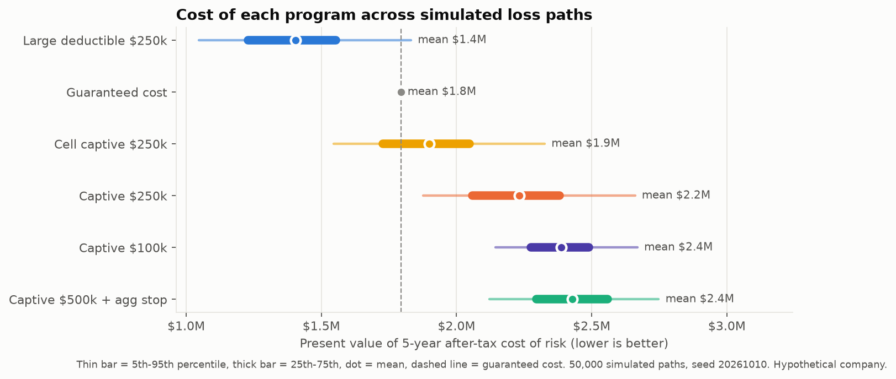
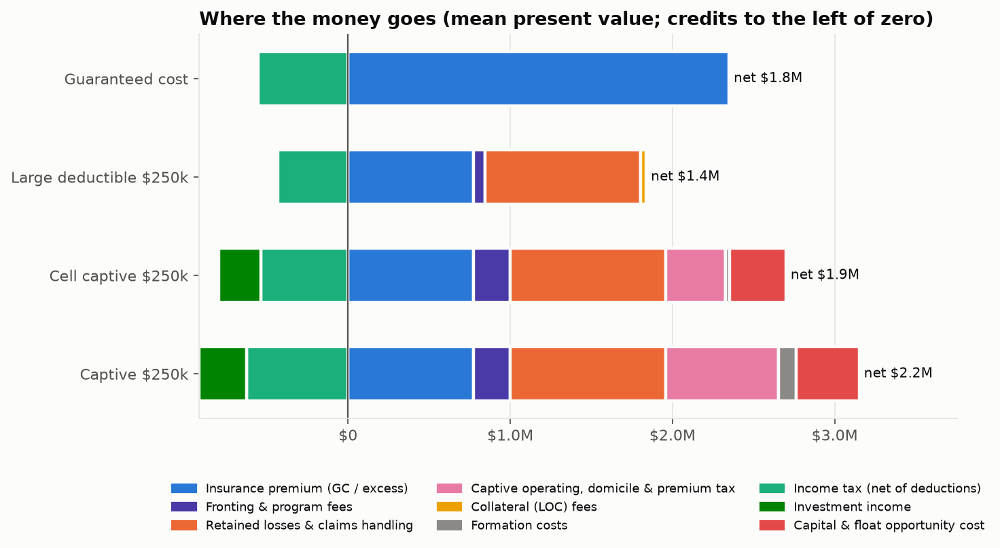
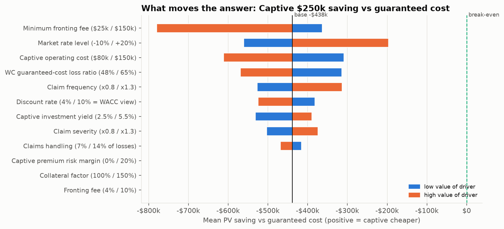
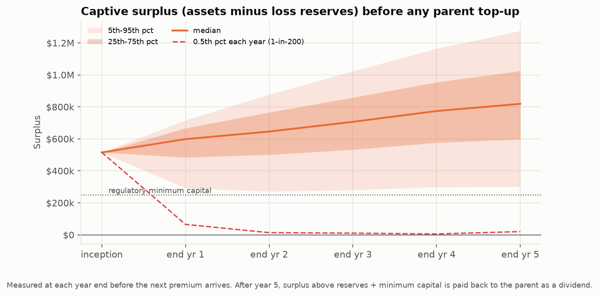
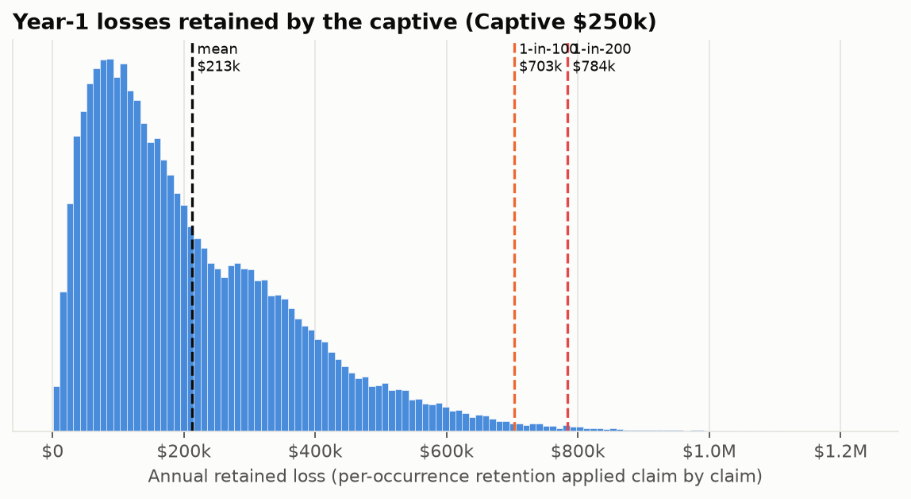
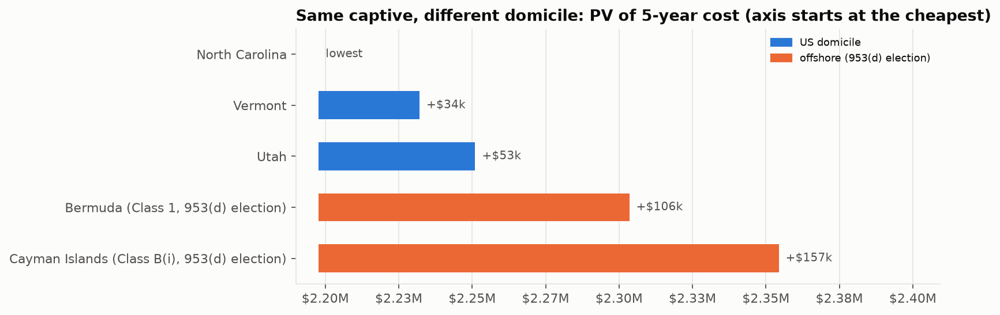
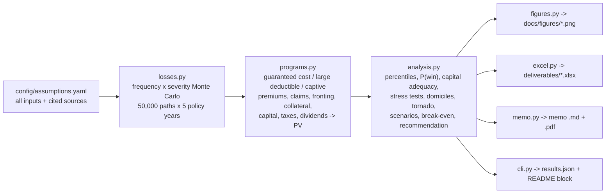

# captive-feasibility-model

**Should a $50M manufacturer form its own insurance company?** A Monte Carlo captive feasibility study that compares guaranteed-cost insurance, a large-deductible program and single-parent / cell captives on 5-year after-tax cost, capital adequacy and domicile. It produces the Excel workbook and CFO memo a broker would deliver.

> **The company is hypothetical, and so is its loss data.** "HypoMfg, Inc." is a made-up US metal-products manufacturer with $50M revenue and 210 employees. Its claims are **simulated** from frequency and severity assumptions. Those assumptions are anchored to public benchmarks where one exists (BLS injury rates, NCCI claim severity, NAIC/NCCI combined ratios, US Treasury yields) and labeled as assumptions where none does. Domicile capital, tax and fee figures come from statutes and regulators, each cited with its URL. This is a student portfolio project, not an actuarial opinion or tax/legal advice.

[](https://github.com/AwpDemon/captive-feasibility-model/actions/workflows/ci.yml)

## The answer

The model **recommends against forming a single-parent captive at HypoMfg's size**. Retaining risk does pay: a $250k large-deductible program cuts the expected 5-year cost of risk by about **$390k (22%)** compared with guaranteed cost, and it is cheaper in 93.5% of simulated paths. Putting that same retention into a Vermont single-parent captive adds about $117k a year of fixed costs, a $50k minimum fronting fee and $515k of capital. The result is **$438k more expensive than guaranteed cost** in present value, and the captive beats guaranteed cost in only 1.4% of paths.

The captive breaks even with guaranteed cost at about **$1.0M of annual guaranteed-cost premium**, roughly 2.1x HypoMfg's current $487k. That matches the $1M to $1.5M minimum premium captive managers quote for a single-parent captive, an independent check that the model behaves sensibly. In the range tested (up to about 6x today's size) the captive never beat the large deductible on expected cost.



## Results

<!-- RESULTS:START -->
**Model decision:** Do not form a single-parent captive now. Move from guaranteed cost to a large deductible $250k program, which lowers the expected 5-year cost by $390,136 (22%). Revisit a captive as premium grows.

_50,000 Monte Carlo paths, seed 20261010, 5 policy years + full run-off, discount rate 6%. Hypothetical company; reproduce with `captive run`._

| Program | Mean PV of 5-yr after-tax cost | 95th pct | Saving vs guaranteed cost | P(cheaper than GC) |
|---|---:|---:|---:|---:|
| Large deductible $250k | $1,403,678 | $1,831,741 | $390,136 | 93.5% |
| Guaranteed cost | $1,793,814 | $1,793,814 | $0 | 0.0% |
| Cell captive $250k | $1,899,894 | $2,326,118 | -$106,080 | 35.7% |
| Captive $250k | $2,232,077 | $2,660,421 | -$438,262 | 1.4% |
| Captive $100k | $2,387,528 | $2,669,015 | -$593,714 | 0.0% |
| Captive $500k + agg stop | $2,429,061 | $2,747,955 | -$635,246 | 0.0% |

| Captive $250k (Vermont) | Value |
|---|---:|
| Year-1 retained loss: mean / 1-in-100 / 1-in-200 | $212,779 / $702,977 / $784,141 |
| Capital held (max of statutory minimum, 1-in-100 VaR need, premium/3) | $515,224 |
| P(surplus dips below statutory minimum in years 1-5) | 12.6% |
| 1-in-200 total parent capital call | $508,693 |
| Break-even vs guaranteed cost (year-1 GC premium) | $1,005,690 (~2.1x today's $486,980) |
| Break-even vs large deductible | not reached in tested range (up to ~6x) |

| Domicile (same captive) | Statutory min capital | Premium tax yr 1 | Mean PV cost |
|---|---:|---:|---:|
| North Carolina | $250,000 | $5,000 | $2,197,769 |
| Vermont | $250,000 | $7,500 | $2,232,077 |
| Utah | $250,000 | $0 | $2,251,020 |
| Bermuda (Class 1, 953(d) election) | $120,000 | $0 | $2,303,488 |
| Cayman Islands (Class B(i), 953(d) election) | $100,000 | $0 | $2,354,360 |

_Generated by `captive run` in 93s._
<!-- RESULTS:END -->

| | |
|---|---|
|  |  |
|  |  |
|  |  |

**What the sensitivity analysis says.** The single biggest driver of the captive-versus-guaranteed-cost gap is the **minimum fronting fee**: a $50k minimum dwarfs the 7% percentage fee on a ~$380k premium, so the percentage fee has *zero* effect in the tornado. Next come the market rate level, the captive's operating cost and the WC loss ratio built into guaranteed-cost pricing. None of the twelve drivers flips the answer alone within its tested range. In the scenarios, a hard market (+25% rates) shrinks the gap to $136k and doubling the company's exposure to $22k. Electing IRC 831(b) barely matters ($6k), because the captive is priced at an arm's-length 63% loss ratio. 831(b) only creates large savings when premiums are inflated relative to losses, and that is the pattern the IRS's 2025 micro-captive regulations target.

## Deliverables

| File | What it is |
|---|---|
| [`deliverables/feasibility_memo.pdf`](deliverables/feasibility_memo.pdf) ([markdown](docs/feasibility_memo.md)) | 4-page broker-style memo to the CFO. The recommendation and every number in it are generated from the model run. |
| [`deliverables/captive_feasibility_model.xlsx`](deliverables/captive_feasibility_model.xlsx) | 12-sheet workbook built by code: assumptions with provenance colours, results, live NPV/IRR formulas behind an editable discount-rate cell, loss model, capital and stress tests, domicile comparison with citations, tornado, scenarios, break-even, 2,000 sample paths and native Excel charts. |
| [`config/assumptions.yaml`](config/assumptions.yaml) | **Every** input in one file, plus a `sources:` block giving each figure a status (verified / benchmark / secondary / assumption), a quote or basis, and a URL. |
| [`results/results.json`](results/results.json) | Full machine-readable output of the run that produced this README. |
| [`docs/INTERVIEW_GUIDE.md`](docs/INTERVIEW_GUIDE.md) | Captives from scratch, the math, every design decision, and interview Q&A. |

## How it works



1. **Losses.** Four lines: workers' compensation, commercial auto liability, general/products liability and non-cat property. Each has an attritional component and, for liability and property, a large-loss component. Claim counts are **negative binomial**, built as a Poisson-Gamma mixture with a variance-to-mean ratio. Severities are **lognormal**, set by mean and CV, for attritional claims, and single-parameter **Pareto** for large losses. Every claim is capped at the per-occurrence limit and trended (WC +4%/yr from NCCI; liability +6%/yr). A shared Gamma "common shock" each year correlates the lines. The base run simulates 3.4 million individual claims, and each claim is split at the retention so every program sees identical losses (common random numbers).
2. **Programs.** *Guaranteed cost*: premium = expected loss / target loss ratio. *Large deductible*: the parent reimburses claims up to $250k, pays an excess premium, a paper fee and claims handling, and posts LOC collateral. *Captive*: same retention, written through a fronting insurer. The parent pays an actuarially priced premium, and the captive holds capital, pays claims, invests the float at 4.5%, pays premium tax, domicile fees and income tax, faces regulator-style capital calls when surplus dips below the statutory minimum, and returns surplus as dividends. All programs run to full claim run-off.
3. **Valuation.** PV at a 6% after-tax opportunity cost of cash, from the parent's point of view. The PV is decomposed into components such as premium, losses, fees, captive costs, tax, investment income and the cost of capital and float.
4. **Capital.** Capital is sized as the larger of the statutory minimum, the 1-in-100 year-1 retained loss beyond the funded loss pick, and premium / 3. The capital section reports 1-in-100 and 1-in-200 retained losses, TVaR, surplus percentile paths, the probability of a capital call and five stress tests.
5. **Decision.** `analysis.recommend()` turns the numbers into the memo's recommendation with explicit rules. No conclusion is typed in by hand.

## Run it

```bash
git clone https://github.com/AwpDemon/captive-feasibility-model && cd captive-feasibility-model
python -m venv .venv && source .venv/bin/activate      # Windows: .venv\Scripts\activate
pip install -r requirements.txt && pip install -e .
captive run          # ~90s: 50,000 paths; regenerates figures, workbook, memo, results.json and the README block
pytest -q            # 43 tests
```

`captive run --quick` does a 5,000-path smoke run, and `captive run --config my.yaml` runs your own assumptions. `docker compose -f deploy/docker-compose.yml run --rm model` runs the same thing in a container.

## How I know the engine is right

- **No-arbitrage identity test.** With every friction switched off (no taxes or fees, and the captive earning exactly the discount rate), a captive must cost exactly the same as a large deductible with the same retention on *every one* of the 20,000 test paths. The test passes to 1e-9 relative tolerance. It exercises the whole captive balance-sheet roll-forward: premiums, claims, capital, capital calls, dividends and investment income.
- **Closed form vs simulation.** Limited expected values E[min(X, u)] are coded analytically for both severity families. They are checked against numerical integration, and the Monte Carlo layer means are checked against them to within 4.5 standard errors.
- **Hand calculations.** The guaranteed-cost PV is checked against a hand formula, Vermont's tiered premium tax against the statute's brackets ($7,500 minimum, $200,000 maximum), and IRR against textbook cases.
- **Consistency.** PV components sum to the total, expected cash flows discount to the mean path PV (so the Excel NPV formula agrees with Python), stressed losses priced on the base pick raise both cost and capital-call probability, and capital never sits below the domicile minimum.

## Data sources and licences

| Source | Used for | Status / licence |
|---|---|---|
| [BLS SOII 2024, Table 1](https://www.bls.gov/iif/nonfatal-injuries-and-illnesses-tables/table-1-injury-and-illness-rates-by-industry-2024-national.htm) | WC claim frequency (NAICS 332: 3.2 recordable, 0.9 DAFW per 100 FTE) | US government work, public domain |
| [NCCI State of the Line 2026](https://www.ncci.com/Articles/Documents/AIS2026-SOTL-Presentation.pdf) | WC lost-time severity (~$30.6K medical + ~$31.3K indemnity), +4% trend, loss and combined ratios by line | Public NCCI publication; figures quoted with citation, nothing redistributed |
| [US Treasury par yield curve, 10/09/2026](https://home.treasury.gov/resource-center/data-chart-center/interest-rates/TextView?type=daily_treasury_yield_curve&field_tdr_date_value_month=202610) | Investment yield anchor (5-yr 5.02%) | US government, public domain |
| [8 V.S.A. 6002, 6004, 6014](https://legislature.vermont.gov/statutes/section/08/141/06014), [N.C.G.S. 58-10-370, 105-228.4A](https://www.ncleg.gov/EnactedLegislation/Statutes/HTML/BySection/Chapter_105/GS_105-228.4A.html), [Utah 31A-37-204](https://le.utah.gov/xcode/Title31a/Chapter37/C31A-37_1800010118000101.pdf) | US domicile capital, premium tax, fees, board-meeting rules | Public law |
| [BMA Insurance Act / 2025 fees](https://cdn.bma.bm/documents/2025-01-13-09-37-05-2025-Bermuda-Monetary-Authority-Fees.pdf), [CIMA capital regs / 2026 fees](https://www.cima.ky/upimages/commonfiles/WebsiteFeeSchedule1January2026Update_1770328410.pdf) | Offshore capital and fees | Public regulator documents |
| [Rev. Proc. 2025-32](https://www.irs.gov/pub/irs-drop/rp-25-32.pdf), [T.D. 10029](https://www.federalregister.gov/documents/2025/01/14/2025-00393/micro-captive-listed-transactions-and-micro-captive-transactions-of-interest), [IRC 4371](https://www.law.cornell.edu/uscode/text/26/4371), [IRC 953](https://www.law.cornell.edu/uscode/text/26/953) | 831(b) limit ($2.9M for 2026), micro-captive loss-ratio tests, FET, 953(d) | US government, public domain |
| Captive International, captive.com, CRI Advisors, IML | Fronting fee range, collateral %, operating and formation costs, minimum viable premium | Secondary (industry/vendor); marked `secondary` in the YAML |

All figures were retrieved on **2026-10-10**. `python scripts/check_sources.py` re-checks that every cited URL still resolves. No raw data files are needed: the model's inputs are the cited figures themselves.

## Limitations (read before quoting a number)

- **The loss pick is the weakest input.** With real loss runs I would develop each accident year to ultimate and credibility-weight the result against industry factors. The fixed seed makes results reproducible, but that does not make them true.
- **Market pricing is stylised.** Premium = expected loss / target loss ratio, with no experience rating, underwriting judgment or market-cycle dynamics beyond the scenarios.
- **Tax is simplified.** Loss reserves are undiscounted (no IRC 846 discounting), tax losses are fully usable, and there are no state self-procurement taxes. The captive's insurance status for tax (risk distribution) is a scenario switch, not a legal conclusion.
- **The discount rate is a judgment.** At 6% the captive pays for parking cash at 4.5%. At a 4% rate the gap with guaranteed cost narrows to $381k, and at a 10% WACC it widens to $525k. Neither changes the decision.
- **Scope.** Catastrophe property, cyber, product recall, employee benefits and third-party business are out of scope. These are often the real reasons mid-size companies form captives, and the model cannot price them.
- **Some sources are secondary**, and a few regulatory facts carry caveats noted in the YAML. Examples: Bermuda's lack of premium tax is confirmed only by law firms; the NCCI severities are read from chart labels; a reported 2026 court ruling on the listed-transaction rule is unverified.

## What I'd do next

- Replace the assumed loss picks with real (or realistic synthetic) loss triangles and fit frequency and severity by maximum likelihood, with a parameter-uncertainty layer.
- Add a group-captive option, plus a captive that writes coverages the market prices badly (deductible buy-back, supply-chain interruption) to test the "coverage, not cost" argument.
- Add a multi-year re-pricing loop so captive premiums respond to emerging experience, and model a loss-portfolio transfer as an exit strategy.
- Ship a small read-only web front end (Streamlit) for the tornado and break-even analysis.

## Repo layout

```
config/assumptions.yaml     every input + sources/provenance
src/captive/                distributions, losses, programs (cash-flow engine), analysis, figures, excel, memo, cli
tests/                      43 tests: closed forms, convergence, no-arbitrage identity, outputs
deliverables/               generated workbook + PDF memo
docs/                       figures, memo (markdown), INTERVIEW_GUIDE.md
results/                    results.json + summary.md from the last run
scripts/check_sources.py    re-verify cited URLs
deploy/                     Dockerfile + compose
```

MIT licence. An independent portfolio project by Ali Askari (UGA Terry College of Business, MIS), built with the help of an AI coding assistant. Every number above is reproducible with `captive run`.
